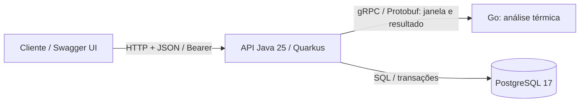

# FrioVax

Backend para gestão de câmaras de conservação, lotes de imunobiológicos
e ocorrências térmicas. Centraliza inventário e leituras simuladas para permitir
que a equipe identifique material potencialmente afetado e registre seu tratamento.

O sistema controla capacidade, mantém histórico e aplica permissões por perfil.
A análise sinaliza desvios; o descarte depende de uma operação explícita por
administrador. Não inclui frontend ou integração com sensores físicos.

## Arquitetura



**Go calcula; Java confirma.** Java envia as leituras anteriores e novas de cada
câmara; Go analisa câmaras concorrentemente, sem banco nem contadores entre chamadas.
Java revalida os dados e persiste leituras, ocorrências, estados e auditoria.
Reiniciar Go não perde a sequência porque o contexto está no PostgreSQL.

| Funcionalidade | Disponível |
|---|---|
| Câmaras/lotes com capacidade, filtros e paginação | Sim |
| Leituras individuais e lotes de até 50; idempotência | Sim |
| Detecção, evidências e resolução explícita de ocorrências | Sim |
| Histórico e política térmica versionada | Sim |
| Resumo com cache de 30 s, invalidação após commit e métricas | Sim |
| Autenticação, três perfis e consulta da auditoria | Sim |

<a id="documentação-openapi-e-swagger-ui"></a>

## Local e no ar

| Ambiente | API / documentação | Comportamento |
|---|---|---|
| Compose local | [API](http://localhost:8080/api/status), [Swagger UI](http://localhost:8080/q/swagger-ui/), [OpenAPI JSON](http://localhost:8080/q/openapi?format=json) | Java, Go e PostgreSQL: fluxo completo |
| Render + Neon | [API pública](https://friovax.onrender.com/api/status), [Swagger UI](https://friovax.onrender.com/q/swagger-ui/), [OpenAPI JSON](https://friovax.onrender.com/q/openapi?format=json) | Java e banco; Go não está publicado |

A API pública pode exigir partida a frio. Sem Go, inventário, histórico e resumo
continuam disponíveis; **novas leituras que exigem análise retornam 503**, sem
confirmar leitura ou ocorrência. Um reenvio já confirmado pode ser recuperado sem Go.
As credenciais locais não dão acesso ao ambiente público. Consulte a
[evidência da publicação e do redeploy](docs/evidencias/sprint-2/smoke-publico.md).

<a id="como-rodar"></a>

## Pré-requisitos e como rodar

Para executar: Docker Engine com Compose (`docker compose`) ou Docker Desktop em execução, portas
8080, 8081 e 5432 livres, internet para o primeiro build e Git para obter o repositório.
Não é necessário instalar Java, Maven, Go, mise ou OpenSSL no host.
As imagens usam Java 25, Go 1.27 e PostgreSQL 17; as ferramentas de desenvolvimento
estão fixadas em [mise.toml](mise.toml). Não foi estabelecida versão mínima de Docker.

```sh
git clone https://github.com/AndreMattheus/FrioVax.git
cd FrioVax
docker compose up --build
```

Aguarde os logs de inicialização. Em **outro terminal na mesma pasta**:

```sh
docker compose ps -a
```

Espere `db`, `api` e `telemetry` como `healthy`. `auth-init` deve terminar com
`Exited (0)`: ele gera chaves e credenciais, depois encerra. A API espera o banco
e essa preparação, sem exigir Go para iniciar. A saúde local está em
[API viva](http://localhost:8080/q/health/live),
[API pronta/banco](http://localhost:8080/q/health/ready) e
[Go](http://localhost:8081/health).

<a id="banco-de-dados"></a>

Os padrões locais funcionam sem arquivo de configuração. Para personalizar,
copie [.env.example](.env.example) para `.env` e ajuste antes da primeira subida:

| Variável do Compose | Padrão | Uso |
|---|---|---|
| `API_PORT` / `TELEMETRY_HTTP_PORT` | `8080` / `8081` | HTTP no host, ligado a 127.0.0.1 |
| `DB_PORT` | `5432` | PostgreSQL no host |
| `DB_NAME` / `DB_USER` / `DB_PASSWORD` | `friovax` | Banco local de demonstração |
| `RESUMO_CACHE_TTL` | `30s` | Validade do cache local do resumo |

Exemplo de `.env`: `API_PORT=18080`. Nesse caso, ajuste a URL dos exemplos.
gRPC fica apenas na rede Compose, em `telemetry:9090`.
Alterar variáveis não troca credenciais de um banco já inicializado.
`docker compose down` preserva dados e chaves; `down -v` apaga os volumes.
Veja [containers e isolamento dos ensaios](docs/containers.md).

## Autenticação e sessões

O Compose gera senhas aleatórias para `administrador`, `operador` e `auditor` no
volume `auth-data`. Os exemplos abaixo leem as senhas diretamente desse ambiente;
não publique sua saída, tokens ou o arquivo `/run/secrets/auth/env.auth`.
Use um volume novo no primeiro ensaio: em banco antigo, as contas mantêm as senhas originais.

| Perfil | Permissões principais |
|---|---|
| ADMINISTRADOR | Cadastros, política, leitura, resolução e auditoria |
| OPERADOR | Consultas, envio de leituras e baixas operacionais |
| AUDITOR | Consultas e auditoria; não envia leituras |

O login emite access JWT de 15 minutos e refresh de 24 horas. Renovação gira o
refresh; logout revoga o refresh enviado, mas o access emitido vale até expirar.
Identidade e perfil vêm do token. Veja [sessões](docs/contrato-api.md#7-autenticação-e-sessões-sprint-2--80)
e [matriz completa](docs/autorizacao.md).

## Demonstração completa

Com o Compose saudável, abra outro terminal **na raiz do repositório** e escolha
um dos roteiros: [PowerShell](#powershell) ou [Bash](#bash). Cada roteiro é completo:
execute os seus blocos numerados em ordem, mantendo o mesmo terminal aberto,
pois as variáveis de uma etapa são usadas nas seguintes. Não é necessário executar os dois.
Se um comando retornar um status diferente do esperado, confira o erro antes de avançar.

O cenário usa uma câmara e um lote fictícios. IDs, códigos e horários são obtidos
ou gerados durante a execução; não é preciso substituí-los manualmente.

```text
Login → câmara → lote → três leituras inseguras → ocorrência aberta
      → reenvio sem duplicação → leitura segura → resolução → consultas
      → verificações de 401/403/503 → Go novamente saudável
```

Na faixa de 2–8 °C, o exemplo percorre estes estados:

```text
9 °C → ATENCAO → 9 °C → ATENCAO → 9 °C → EM_ALERTA
4 °C → EM_ALERTA (aguarda tratamento) → resolução → NORMAL
```

### PowerShell

Use PowerShell e `curl.exe`, com a API acessível em `http://localhost:8080`.
Se alterou `API_PORT`, ajuste `$base` no primeiro bloco.
A função `Chamar` recebe método, rota, status esperado e, quando necessário, o corpo da requisição.
Por exemplo, `Chamar GET /api/resumo 200` consulta o resumo e exige uma resposta 200.

#### 1. Preparar o auxiliar de chamadas

Define a URL e a função usada nos próximos passos. Ela envia o JSON, inclui o token quando houver e confere o status HTTP esperado. **Ainda não faz nenhuma chamada à API.**

```powershell
$base = 'http://localhost:8080'
$token = ''
function Chamar($metodo, $rota, $esperado, $dados = $null) {
    $argumentos = @('-sS', '--max-time', '20', '-X', $metodo, "$base$rota", '-w', "`n%{http_code}")
    if ($token) { $argumentos += @('-H', "Authorization: Bearer $token") }
    if ($null -ne $dados) {
        $argumentos += @('-H', 'Content-Type: application/json', '--data-binary', '@-')
        $saida = ($dados | ConvertTo-Json -Depth 10 -Compress) | & curl.exe @argumentos
    } else { $saida = & curl.exe @argumentos }
    if ($LASTEXITCODE -ne 0) { throw 'Falha de transporte HTTP' }
    $texto = $saida -join "`n"
    $fim = $texto.LastIndexOf("`n")
    $status = [int]$texto.Substring($fim + 1)
    Write-Host "$metodo $rota -> $status (esperado $esperado)"
    if ($status -ne $esperado) { throw "Resposta inesperada em $rota" }
    $corpo = $texto.Substring(0, $fim)
    if ($corpo) { return ($corpo | ConvertFrom-Json) }
}
```

#### 2. Ler as credenciais e fazer login

Lê as senhas geradas pelo Compose e autentica o administrador. O token fica guardado na variável `token` para autorizar os próximos comandos. **Esperado:** login com HTTP 200; a senha e o token não são impressos.

```powershell
$senhas = @{}
docker compose exec -T api cat /run/secrets/auth/env.auth | ForEach-Object {
    $par = $_ -split '=', 2
    if ($par.Count -eq 2) { $senhas[$par[0]] = $par[1] }
}
$sessao = Chamar POST /api/auth/login 200 @{login='administrador'; senha=$senhas.AUTH_DEMO_ADMINISTRADOR}
$token = $sessao.accessToken
```

#### 3. Cadastrar uma câmara

Cria uma câmara com capacidade para 100 doses e faixa segura de 2 a 8 °C. O sufixo evita repetir o código de um cadastro anterior, e `id` guarda o identificador retornado pela API. **Esperado:** HTTP 201.

```powershell
$sufixo = [DateTimeOffset]::UtcNow.ToUnixTimeSeconds()
$camara = Chamar POST /api/camaras 201 @{
    codigo="DOC-$sufixo"; nome='Camara demonstracao'; unidade='UBS demonstracao'
    capacidade=100; temperaturaMinima=2.0; temperaturaMaxima=8.0; estado='OPERACIONAL'
}
$id = $camara.id
```

#### 4. Cadastrar um lote na câmara

Aloca 20 doses na câmara recém-criada, usando uma validade futura. **Esperado:** HTTP 201; a ocupação passa a ser 20 de 100 doses.

```powershell
$lote = Chamar POST /api/lotes 201 @{
    codigo="LOTE-$sufixo"; imunobiologico='Demonstracao'; fabricante='Ficticio'
    validade=(Get-Date).AddYears(1).ToString('yyyy-MM-dd', [cultureinfo]::InvariantCulture); quantidade=20; camaraId=$id
}
```

#### 5. Enviar três leituras inseguras

Envia 9 °C três vezes, em instantes crescentes. Como o limiar inicial é 3, as duas primeiras deixam a câmara em ATENCAO e a terceira abre uma ocorrência. Guarde o identificador da ocorrência para consultar e resolver depois. **Esperado:** três respostas 201, classificação INSEGURA e sequências 1, 2 e 3.

```powershell
$inicio = [DateTimeOffset]::UtcNow.AddMinutes(-1)
foreach ($i in 1..3) {
    $entrada = @{idExterno="doc-$sufixo-$i"; camaraId=$id; temperatura=9.0
        medidaEm=$inicio.AddSeconds($i).ToString('yyyy-MM-ddTHH:mm:ssZ', [cultureinfo]::InvariantCulture); origem='README'}
    $leitura = Chamar POST /api/leituras 201 $entrada
    $leitura | Select-Object id, classificacao, sequencia, ocorrenciaAbertaId | Format-List
}
$ocorrenciaId = $leitura.ocorrenciaAbertaId
```

#### 6. Reenviar e conferir o alerta

Reenvia exatamente a terceira leitura: isso demonstra **idempotência**, ou seja, repetir a mesma entrada não cria outra leitura nem outra ocorrência. Em seguida, consulta a câmara e a ocorrência. **Esperado:** reenvio 200 com o mesmo ID, ocupação 20, câmara EM_ALERTA e ocorrência ABERTA com o lote afetado.

```powershell
$repetida = Chamar POST /api/leituras 200 $entrada
if ($repetida.id -ne $leitura.id) { throw 'Reenvio mudou o ID' }
Chamar GET "/api/camaras/$id" 200 | Select-Object id, ocupacao, estadoTermico | Format-List
Chamar GET "/api/ocorrencias/$ocorrenciaId" 200 | Select-Object id, estado, lotesAfetados | Format-List
```

#### 7. Enviar uma leitura segura

Registra 4 °C e consulta o estado da câmara. Uma temperatura segura interrompe a sequência insegura, mas não encerra o tratamento da ocorrência. **Esperado:** leitura 201 e câmara ainda EM_ALERTA.

```powershell
$segura = Chamar POST /api/leituras 201 @{
    idExterno="doc-$sufixo-4"; camaraId=$id; temperatura=4.0
    medidaEm=$inicio.AddSeconds(4).ToString('yyyy-MM-ddTHH:mm:ssZ', [cultureinfo]::InvariantCulture); origem='README'
}
Chamar GET "/api/camaras/$id" 200 | Select-Object estadoTermico | Format-List
```

#### 8. Resolver a ocorrência

O administrador registra uma justificativa de tratamento e consulta novamente a câmara. **Esperado:** HTTP 200, ocorrência RESOLVIDA e câmara NORMAL.

```powershell
Chamar POST "/api/ocorrencias/$ocorrenciaId/resolucao" 200 @{justificativa='Tratamento demonstrativo registrado'} | Select-Object id, estado, resolvidaEm | Format-List
Chamar GET "/api/camaras/$id" 200 | Select-Object estadoTermico | Format-List
```

#### 9. Consultar o histórico e o resumo

Confere as leituras persistidas e a atualidade do resumo. `geradoEm` indica quando o resumo foi calculado; `validade` indica quando seu cache expira. **Esperado:** HTTP 200 e quatro leituras no histórico, pois o reenvio não criou uma quinta.

```powershell
Chamar GET "/api/camaras/$id/leituras?size=20" 200 | Select-Object totalElements | Format-List
Chamar GET /api/resumo 200 | Select-Object geradoEm, validade | Format-List
```

#### 10. Conferir acesso sem token

Guarda o token administrativo e retira a autenticação da próxima consulta. **Esperado:** HTTP 401. Esse código indica token ausente ou inválido; o corpo pode estar vazio.

```powershell
$adminToken = $token
$token = ''
$null = Chamar GET /api/camaras 401
```

#### 11. Conferir a permissão do auditor

Faz login como auditor e tenta enviar uma leitura. Esse perfil pode consultar, mas não registrar leituras. Ao final, restaura o token do administrador. **Esperado:** login 200 e envio 403, sem alteração nos dados. O corpo do 403 pode estar vazio.

```powershell
$auditor = Chamar POST /api/auth/login 200 @{login='auditor'; senha=$senhas.AUTH_DEMO_AUDITOR}
$token = $auditor.accessToken
$null = Chamar POST /api/leituras 403 $entrada
$token = $adminToken
```

#### 12. Conferir o comportamento sem Go

Para somente o serviço Go e tenta enviar uma leitura nova. Em seguida, consulta os dados já persistidos. **Esperado:** envio 503 com `type=/problemas/analise-indisponivel`, histórico ainda com quatro leituras e consultas com HTTP 200. O prazo interno de cada RPC é 800 ms; o tempo HTTP também inclui rede e banco.

```powershell
docker compose stop telemetry
$falha = @{idExterno="doc-$sufixo-sem-go"; camaraId=$id; temperatura=9.0
    medidaEm=[DateTimeOffset]::UtcNow.ToString('yyyy-MM-ddTHH:mm:ssZ', [cultureinfo]::InvariantCulture); origem='README'}
Chamar POST /api/leituras 503 $falha | Select-Object type, status | Format-List
Chamar GET "/api/camaras/$id/leituras" 200 | Select-Object totalElements | Format-List
Chamar GET /api/camaras 200 | Select-Object totalElements | Format-List
Chamar GET /api/resumo 200 | Select-Object geradoEm | Format-List
```

#### 13. Iniciar Go novamente

Religa o serviço parado no passo anterior. Confira `telemetry` como `healthy` antes de enviar novas leituras. A entrada rejeitada no passo anterior não foi colocada em fila: só será processada se você a reenviar.

```powershell
docker compose start telemetry
docker compose ps
```

### Bash

Use Bash 4.2+ (Linux/macOS com Bash atualizado ou Git Bash no Windows).
As chamadas executam o `curl` já incluído no container da API, sem instalar `jq`
ou Python. Por isso, `base` usa a porta **interna** 8080 mesmo se `API_PORT` mudar.
A função `chamar` recebe método, rota, status esperado e um corpo opcional;
`resposta` guarda o JSON retornado. Os auxiliares `numero` e `texto` extraem somente
os campos simples usados nesta demonstração; para integrações reais, use um parser JSON.
Se aparecer **PARE**, confira o erro e repita a etapa antes de avançar. A função
retorna uma falha sem encerrar o terminal; no envio das três leituras, `break`
interrompe somente o laço caso uma chamada falhe.

#### 1. Preparar o auxiliar de chamadas

Define a URL e a função usada nos próximos passos. Ela envia o JSON, inclui o token quando houver e confere o status HTTP esperado. **Ainda não faz nenhuma chamada à API.**

```bash
export MSYS_NO_PATHCONV=1 # Git Bash: preserva caminhos Linux nos comandos Docker
base=http://localhost:8080
token=
chamar() {
  local metodo=$1 rota=$2 esperado=$3 saida status
  local args=(-sS --max-time 20 -X "$metodo" "$base$rota" -w $'\n%{http_code}')
  [[ -z $token ]] || args+=(-H "Authorization: Bearer $token")
  if [[ $# == 4 ]]; then
    args+=(-H 'Content-Type: application/json' --data-binary @-)
    saida=$(printf '%s' "$4" | docker compose exec -T api curl "${args[@]}") || return 1
  else
    saida=$(docker compose exec -T api curl "${args[@]}") || return 1
  fi
  status=${saida##*$'\n'}
  resposta=${saida%$'\n'*}
  printf '%s %s -> %s (esperado %s)\n' "$metodo" "$rota" "$status" "$esperado"
  if [[ $status != "$esperado" ]]; then
    printf '%s\n' 'PARE: confira a resposta acima antes de seguir para o próximo bloco.' >&2
    return 1
  fi
}
numero() { local padrao="\"$1\"[[:space:]]*:[[:space:]]*([0-9]+)"; [[ $resposta =~ $padrao ]] && printf '%s' "${BASH_REMATCH[1]}"; }
texto() { local padrao="\"$1\"[[:space:]]*:[[:space:]]*\"([^\"]*)\""; [[ $resposta =~ $padrao ]] && printf '%s' "${BASH_REMATCH[1]}"; }
```

#### 2. Ler as credenciais e fazer login

Lê as senhas geradas pelo Compose e autentica o administrador. O token fica guardado na variável `token` para autorizar os próximos comandos. **Esperado:** login com HTTP 200; a senha e o token não são impressos.

```bash
while IFS='=' read -r chave valor; do
  case $chave in
    AUTH_DEMO_ADMINISTRADOR) senha_admin=$valor ;;
    AUTH_DEMO_AUDITOR) senha_auditor=$valor ;;
  esac
done < <(docker compose exec -T api cat /run/secrets/auth/env.auth)
chamar POST /api/auth/login 200 "{\"login\":\"administrador\",\"senha\":\"$senha_admin\"}"
token=$(texto accessToken)
```

#### 3. Cadastrar uma câmara

Cria uma câmara com capacidade para 100 doses e faixa segura de 2 a 8 °C. O sufixo evita repetir o código de um cadastro anterior, e `id` guarda o identificador retornado pela API. **Esperado:** HTTP 201.

```bash
printf -v sufixo '%(%s)T' -1
export TZ=UTC
printf -v validade '%(%Y-%m-%d)T' "$((sufixo+366*86400))"
chamar POST /api/camaras 201 "{
  \"codigo\":\"DOC-$sufixo\",
  \"nome\":\"Camara demonstracao\",
  \"unidade\":\"UBS demonstracao\",
  \"capacidade\":100,
  \"temperaturaMinima\":2.0,
  \"temperaturaMaxima\":8.0,
  \"estado\":\"OPERACIONAL\"
}"
id=$(numero id)
```

#### 4. Cadastrar um lote na câmara

Aloca 20 doses na câmara recém-criada, usando uma validade futura. **Esperado:** HTTP 201; a ocupação passa a ser 20 de 100 doses.

```bash
chamar POST /api/lotes 201 "{
  \"codigo\":\"LOTE-$sufixo\",
  \"imunobiologico\":\"Demonstracao\",
  \"fabricante\":\"Ficticio\",
  \"validade\":\"$validade\",
  \"quantidade\":20,
  \"camaraId\":$id
}"
```

#### 5. Enviar três leituras inseguras

Envia 9 °C três vezes, em instantes crescentes. Como o limiar inicial é 3, as duas primeiras deixam a câmara em ATENCAO e a terceira abre uma ocorrência. Guarde o identificador da ocorrência para consultar e resolver depois. **Esperado:** três respostas 201, classificação INSEGURA e sequências 1, 2 e 3.

```bash
for i in 1 2 3; do
  printf -v medida '%(%Y-%m-%dT%H:%M:%SZ)T' "$((sufixo-60+i))"
  entrada="{
    \"idExterno\":\"doc-$sufixo-$i\",
    \"camaraId\":$id,
    \"temperatura\":9.0,
    \"medidaEm\":\"$medida\",
    \"origem\":\"README\"
  }"
  chamar POST /api/leituras 201 "$entrada" || break
  printf 'classificacao=%s sequencia=%s\n' "$(texto classificacao)" "$(numero sequencia)"
done
ocorrencia_id=$(numero ocorrenciaAbertaId)
leitura_id=$(numero id)
```

#### 6. Reenviar e conferir o alerta

Reenvia exatamente a terceira leitura: isso demonstra **idempotência**, ou seja, repetir a mesma entrada não cria outra leitura nem outra ocorrência. Em seguida, consulta a câmara e a ocorrência. **Esperado:** reenvio 200 com o mesmo ID, ocupação 20, câmara EM_ALERTA e ocorrência ABERTA com o lote afetado.

```bash
chamar POST /api/leituras 200 "$entrada"
[[ $(numero id) == "$leitura_id" ]] || printf '%s\n' 'PARE: o reenvio mudou o ID; confira a resposta antes de seguir.' >&2
chamar GET "/api/camaras/$id" 200
printf 'ocupacao=%s estadoTermico=%s\n' "$(numero ocupacao)" "$(texto estadoTermico)"
chamar GET "/api/ocorrencias/$ocorrencia_id" 200
printf '%s\n' "$resposta"
```

#### 7. Enviar uma leitura segura

Registra 4 °C e consulta o estado da câmara. Uma temperatura segura interrompe a sequência insegura, mas não encerra o tratamento da ocorrência. **Esperado:** leitura 201 e câmara ainda EM_ALERTA.

```bash
printf -v medida '%(%Y-%m-%dT%H:%M:%SZ)T' "$((sufixo-56))"
chamar POST /api/leituras 201 "{
  \"idExterno\":\"doc-$sufixo-4\",
  \"camaraId\":$id,
  \"temperatura\":4.0,
  \"medidaEm\":\"$medida\",
  \"origem\":\"README\"
}"
chamar GET "/api/camaras/$id" 200
printf 'Apos segura: %s\n' "$(texto estadoTermico)"
```

#### 8. Resolver a ocorrência

O administrador registra uma justificativa de tratamento e consulta novamente a câmara. **Esperado:** HTTP 200, ocorrência RESOLVIDA e câmara NORMAL.

```bash
chamar POST "/api/ocorrencias/$ocorrencia_id/resolucao" 200 '{"justificativa":"Tratamento demonstrativo registrado"}'
printf 'Ocorrencia: %s\n' "$(texto estado)"
chamar GET "/api/camaras/$id" 200
printf 'Apos resolucao: %s\n' "$(texto estadoTermico)"
```

#### 9. Consultar o histórico e o resumo

Confere as leituras persistidas e a atualidade do resumo. `geradoEm` indica quando o resumo foi calculado; `validade` indica quando seu cache expira. **Esperado:** HTTP 200 e quatro leituras no histórico, pois o reenvio não criou uma quinta.

```bash
chamar GET "/api/camaras/$id/leituras?size=20" 200
printf 'Leituras persistidas: %s\n' "$(numero totalElements)"
chamar GET /api/resumo 200
printf '%s\n' "$resposta"
```

#### 10. Conferir acesso sem token

Guarda o token administrativo e retira a autenticação da próxima consulta. **Esperado:** HTTP 401. Esse código indica token ausente ou inválido; o corpo pode estar vazio.

```bash
admin_token=$token
token=
chamar GET /api/camaras 401
```

#### 11. Conferir a permissão do auditor

Faz login como auditor e tenta enviar uma leitura. Esse perfil pode consultar, mas não registrar leituras. Ao final, restaura o token do administrador. **Esperado:** login 200 e envio 403, sem alteração nos dados. O corpo do 403 pode estar vazio.

```bash
chamar POST /api/auth/login 200 "{\"login\":\"auditor\",\"senha\":\"$senha_auditor\"}"
token=$(texto accessToken)
chamar POST /api/leituras 403 "$entrada"
token=$admin_token
```

#### 12. Conferir o comportamento sem Go

Para somente o serviço Go e tenta enviar uma leitura nova. Em seguida, consulta os dados já persistidos. **Esperado:** envio 503 com `type=/problemas/analise-indisponivel`, histórico ainda com quatro leituras e consultas com HTTP 200. O prazo interno de cada RPC é 800 ms; o tempo HTTP também inclui rede e banco.

```bash
docker compose stop telemetry
printf -v medida '%(%Y-%m-%dT%H:%M:%SZ)T' -1
chamar POST /api/leituras 503 "{
  \"idExterno\":\"doc-$sufixo-sem-go\",
  \"camaraId\":$id,
  \"temperatura\":9.0,
  \"medidaEm\":\"$medida\",
  \"origem\":\"README\"
}"
printf '%s\n' "$resposta"
chamar GET "/api/camaras/$id/leituras" 200
printf 'Leituras apos 503: %s\n' "$(numero totalElements)"
chamar GET /api/camaras 200
chamar GET /api/resumo 200
```

#### 13. Iniciar Go novamente

Religa o serviço parado no passo anterior. Confira `telemetry` como `healthy` antes de enviar novas leituras. A entrada rejeitada no passo anterior não foi colocada em fila: só será processada se você a reenviar.

```bash
docker compose start telemetry
docker compose ps
```

Outros erros possíveis são 400 para JSON/parâmetro inválido, 409 para conflito
(incluindo capacidade), 422 para validação e 502 para falha do contrato de integração.
As regras completas estão no [contrato da API](docs/contrato-api.md).

## Como testar e desenvolver

Para desenvolvimento, instale [mise](https://mise.jdx.dev/), revise as tarefas e execute
`mise trust` e `mise install`. A suíte completa exige Docker, mas não exige subir o Compose.

| Comando na raiz | O que verifica |
|---|---|
| `mise run test-unit` | Domínio e casos de uso Java sem banco |
| `mise run test-http` | HTTP, autorização e documentação com repositórios em memória |
| `mise run test` | Suíte Java completa (banco, arquitetura e fluxo real) e testes Go |
| `mise run lint` | Buf, Spotless, gofmt e go vet |
| `mise run ci` | Pipeline local completo, incluindo gerados, race detector, scripts Python e smoke |

Veja [desenvolvimento, autenticação no host e ferramentas](docs/desenvolvimento.md),
[comandos do CI](docs/ci.md) e [Protobuf e geração](protos/README.md).
OpenAPI é gerada das anotações Java; Swagger UI permite executar as operações
com **Authorize** usando o access token. O Postman também importa `/q/openapi`.

## Documentos e evidências

- Produto: [proposta](docs/proposta.md), [backlog inicial e evolução](docs/backlog.md),
  [contrato HTTP](docs/contrato-api.md), [acesso](docs/autorizacao.md), [resumo/cache](docs/resumo.md).
- Decisões: [ADR 0001 — histórico](docs/decisoes/0001-arquitetura-em-camadas.md),
  [ADR 0002 — domínio independente](docs/decisoes/0002-dominio-independente-e-aplicacao-por-interfaces.md),
  [ADR 0003 — Go](docs/decisoes/0003-servico-go-telemetria.md),
  [ADR 0004 — implantação](docs/decisoes/0004-implantacao.md).
- Operação: [containers](docs/containers.md), [implantação](docs/implantacao.md),
  [fluxo Java–Go–banco](docs/evidencias/sprint-2/validacao/fluxo-real-83.md),
  [smoke público](docs/evidencias/sprint-2/smoke-publico.md),
  [proteção de main](docs/evidencias/sprint-2/protecao-main.md).
- Processo: [acordo](docs/processo.md), [medição](docs/medicao-sprint-2.md),
  [DORA](docs/metricas-02.md), [fluxo de valor e experimento](docs/fluxo-de-valor.md),
  [uso de IA](docs/uso-de-ia.md), [Project](https://github.com/users/AndreMattheus/projects/1).
- Histórico da Sprint 1: [checklist](docs/checklist-sprint-1.md),
  [validação](docs/validacao-sprint-1.md), [métricas](docs/metricas-sprint-1.md),
  [retrospectiva](docs/retrospectiva-01.md).

## Vídeos e próximas conferências

[Vídeo da Sprint 1](https://www.youtube.com/watch?v=Jerz6RtwuYE).
Os dois vídeos da Sprint 2 serão publicados pela [#96](https://github.com/AndreMattheus/FrioVax/issues/96),
com base nos guias das disciplinas e nos [roteiros históricos](docs/roteiro-video-sprint-1.md).

## Equipe e licença

Grupo FrioVax, coorte B, produto comum de DIM0547 (Web II) e DIM0510 (Processos).

| Integrante | Matrícula | GitHub | Coordenação |
|---|---|---|---|
| Arthur Feijo de Medeiros | 20240012792 | [arthurFeijo](https://github.com/arthurFeijo) | Qualidade e DevOps |
| Bianca Maciel Medeiros | 20230044970 | [biancammedeiros](https://github.com/biancammedeiros) | Produto e domínio |
| Leonardo Nadson Oliveira de Medeiros | 20240028925 | [leonardonadson](https://github.com/leonardonadson) | Processo |
| Matheus Andre Souza Cirilo | 20240030941 | [AndreMattheus](https://github.com/AndreMattheus) | Arquitetura e Go |

Todos desenvolvem; papéis não conferem propriedade exclusiva de código.
Licença [MIT](LICENSE), Copyright 2026 Equipe FrioVax.
