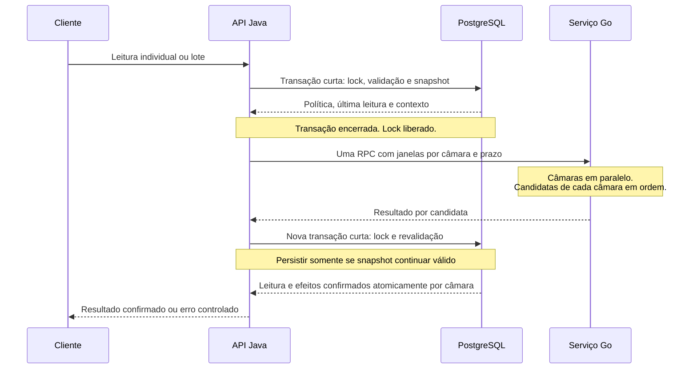

# ADR 0003 — Serviço Go de telemetria e regras térmicas

- **Status:** Vigente
- **Data:** 04/11/2026
- **Issue:** [#67](https://github.com/AndreMattheus/FrioVax/issues/67)
- **Relaciona-se com:** [ADR 0002 — Domínio independente e aplicação por interfaces](0002-dominio-independente-e-aplicacao-por-interfaces.md)

## Contexto

O FrioVax recebe leituras simuladas de câmaras de conservação e precisa reconhecer sequências fora da faixa configurada. A API Java mantém câmaras, lotes e suas regras transacionais. Atualmente, o serviço Go implementa somente a rota HTTP de saúde; esta ADR especifica comportamento futuro planejado.

No domínio do produto, há processamento de sequências e concorrência entre câmaras independentes. A chamada entre serviços envolve espera de rede, mas a análise Go escolhida não depende de terceiros nem de agendamento. Não se pretende introduzir sensores, streaming, filas ou notificações externas.

A proposta anterior atribuía ao Go contadores transitórios entre chamadas. Isso deixaria a detecção dependente da memória de um processo: um reinício entre a segunda e a terceira leitura insegura poderia perder a sequência. Reenvios e rollback no Java também exigiriam sincronizar esse estado com o que realmente foi confirmado no banco.

## Decisão

**O serviço Go analisa concorrentemente janelas de leituras de diferentes câmaras, respeitando cancelamento e prazo, e devolve resultados térmicos determinísticos para confirmação pela API Java.**

### 1. Responsabilidade e fronteiras

Java é a autoridade sobre os dados oficiais: câmaras, políticas, leituras, ocorrências, lotes e auditoria. Go calcula classificação, sequência, sinal de limiar e evidências por candidata. Não acessa tabelas do Java, não possui banco e não confirma efeitos oficiais.

A separação isola a execução concorrente da análise em um processo próprio e permite evoluir sua implementação atrás de um contrato explícito, preservando no Java as transações do inventário. Não é a divisão de um CRUD. Se a análise compartilhasse o processo da API, sua execução e seu consumo de recursos compartilhariam também o ciclo de execução da API; a fronteira escolhida torna essa responsabilidade remota e exige tratar prazo, falha de rede e compatibilidade.

O domínio Go permanece sem HTTP/gRPC; adaptadores traduzem contrato e erros. Uma goroutine é uma unidade de execução concorrente: haverá uma por câmara da chamada, coordenada por `errgroup` e `context.Context`. Câmaras diferentes podem avançar em paralelo; as leituras de uma mesma câmara são analisadas em ordem. Cancelamento e deadline devem ser observados durante o processamento, encerrando todas as goroutines da chamada. Não há goroutine residente ou contador oficial entre chamadas.

Com `errgroup.WithContext`, um erro não nulo retornado por uma goroutine cancela o contexto do grupo. Por isso, erros esperados de validação de uma janela são registrados como resultado de erro daquela câmara, e a função entregue ao grupo retorna `nil`, permitindo concluir as outras câmaras. Cada goroutine escreve somente na posição de sua janela em uma coleção previamente dimensionada; os resultados são lidos após `Wait`, preservando ordem e evitando escrita concorrente na mesma posição. Cancelamento, deadline e falhas internas que comprometem a chamada inteira retornam erro ao grupo e interrompem a RPC, sem confirmar resultados parciais.

No Java, a aplicação usa uma porta independente de transporte; o adaptador gRPC converte os dados e trata os códigos remotos. Domínio e aplicação não importam `io.grpc` nem tipos gerados, preservando a direção de dependências da ADR 0002.

### 2. Política, limiar e sequência

**Política térmica** é o conjunto de temperatura mínima, temperatura máxima e quantidade de leituras inseguras consecutivas exigida para sinalizar uma ocorrência. **Política vigente** é a versão atualmente válida para novas leituras daquela câmara. Cada leitura conserva a versão usada em sua análise; o histórico não é reclassificado quando a política muda.

**Limiar N** é essa quantidade exigida, um inteiro de 1 a 100. O valor inicial 3 é apenas de demonstração. A migração preservará a faixa já cadastrada de cada câmara, sem impor 2–8 °C a todas.

- Temperatura igual ao mínimo ou máximo é segura; menor que o mínimo ou maior que o máximo é insegura.
- Usar décimos de grau, sem arredondamento implícito. Preservar as validações de faixa e precisão do [contrato atual](../contrato-api.md).
- Uma sequência insegura reúne leituras consecutivas fora da faixa. Valores abaixo e acima contam na mesma sequência; não precisam desviar na mesma direção.
- Uma leitura segura zera a sequência. Tempo sem medição não zera a contagem nem gera alerta de ausência.
- A contagem retornada é limitada a N: `min(contagem, N)`. Ela mede progresso até o limiar, não o total histórico de leituras inseguras. O sinal indica que a candidata insegura atingiu ou mantém o limiar; Java impede novas aberturas enquanto existir ocorrência aberta.
- Alteração real de faixa ou limiar cria versão, autor e instante. Envio sem mudança não cria versão. Alterações pelo PUT da câmara e pela rota de política usam a mesma fonte oficial; mudança apenas de faixa preserva o limiar.
- Uma nova versão reinicia a sequência. Sem ocorrência aberta, o estado passa a `SEM_LEITURAS` até a primeira leitura dessa versão; com ocorrência aberta, conserva `EM_ALERTA`.

### 3. Janela determinística e resultados

Java envia política, correlação, contexto persistido e candidatas novas separados por câmara. Há uma janela por câmara em um único RPC, com até 50 candidatas no total e até N−1 leituras de contexto por câmara (máximo 99). N=1 dispensa contexto.

O contexto contém as últimas leituras aceitas da política vigente, em ordem cronológica, sem atravessar o reinício do episódio após resolução. As candidatas da mesma câmara são ordenadas por instante; instantes novos iguais são inválidos. O contexto participa do cálculo, mas não produz outra leitura persistida nem reaplica efeitos de ocorrências anteriores.

Por exemplo, com N=3, Java envia as duas anteriores `[9,9]` e a nova `[10]`. Go calcula sequência 3 mesmo após reiniciar, pois não precisa lembrar a chamada anterior. Dada a mesma janela e política válidas, o resultado é o mesmo.

Go devolve classificação, sequência limitada a N, sinal e evidências para cada candidata, preservando a ordem das janelas e das candidatas recebidas. Java recompõe a posição original das entradas do lote HTTP. Não reduzir o resultado à última leitura: com faixa 2–8, N=3 e candidatas `9,9,9,4`, a terceira sinaliza o limiar e a quarta zera a sequência, sem apagar o sinal anterior.

Janelas inválidas, políticas incoerentes e mistura de câmaras/versões dentro de uma janela geram erros nomeados, convertidos em resultado de erro para a câmara correspondente, sem resultados térmicos aplicáveis às suas candidatas. O domínio preserva a identidade do erro ao acrescentar contexto (`%w`/`errors.Is`). Essas validações também protegem o contrato interno, mesmo após a validação feita por Java. Uma estrutura global inválida que impeça identificar as janelas e associar seus resultados é falha da chamada inteira.

### 4. Estado térmico e ocorrência

O estado térmico é independente de `ativo` e do estado operacional (`OPERACIONAL`, `MANUTENCAO`, `DESATIVADA`). A análise não altera esses campos, doses ou estado de descarte.

| Estado térmico | Significado |
|---|---|
| `SEM_LEITURAS` | Nenhuma leitura considerada na política vigente; também é o estado inicial, sem inventar medições. |
| `NORMAL` | Última leitura segura e nenhuma ocorrência aberta. |
| `ATENCAO` | Sequência insegura abaixo de N e nenhuma ocorrência aberta; não bloqueia lotes. |
| `EM_ALERTA` | Existe ocorrência aberta; prevalece mesmo após leitura segura ou mudança de política. |

**Ocorrência aberta** é o registro persistido de uma excursão detectada que ainda não recebeu resolução explícita. Na candidata que atinge N, Java confirma leitura, ocorrência, evidências, snapshot dos lotes, estado térmico e auditoria na mesma transação. O snapshot é a fotografia da identidade e quantidade dos lotes no momento da abertura; movimentação ou inativação posterior não o modifica. Uma falha reverte todos os efeitos daquela transação. Eventos de sucesso/mudança confirmada são publicados somente após commit.

Uma regra de domínio e uma constraint no banco garantem no máximo uma ocorrência aberta por câmara. Leituras adicionais não duplicam o episódio. A câmara em `EM_ALERTA` recusa novo lote, aumento de doses, movimentação para ela e baixa com motivo `ADMINISTRADA` (`409`). Enquanto houver ocorrência aberta, a baixa `ADMINISTRADA` é rejeitada sem alterar quantidade, mesmo após uma leitura segura. Retirada/movimentação para fora, baixa por `PERDA` e descarte permanecem permitidos, respeitando as demais regras existentes. Permitir retirada não representa liberação para uso dos lotes identificados no snapshot. Não há descarte automático.

A resolução é explícita, por administrador autenticado, com justificativa e autoria/instante oficiais. Sob lock da câmara, exige que a última leitura aceita seja segura, posterior à abertura e da política atual. Uma segura antiga seguida de insegura não atende à condição. Resolução, auditoria e retorno a `NORMAL` são atômicos; o próximo episódio começa com sequência zerada e recebe outro ID. Preservar o histórico, sem reabrir a ocorrência resolvida. Reenvio idêntico recupera o tratamento original; conteúdo conflitante retorna `409`.

### 5. Identidade, ordem e revalidação otimista

A chave externa é `(camaraId, idExterno)`. Reenvio com o mesmo conteúdo recupera o resultado confirmado, sem alimentar novamente a sequência ou chamar Go. Outro conteúdo com a mesma chave retorna `409`. A comparação usa temperatura em décimos, instante normalizado para UTC e origem após `trim`; não se introduz normalização silenciosa de `idExterno`. A leitura conserva entrada, política e resultado confirmado para permitir essa recuperação.

O instante exige offset explícito. Uma candidata deve ser estritamente posterior à última leitura aceita da câmara; instante igual ou anterior retorna `409`. Mais de cinco minutos no futuro retorna `422`, usando o relógio injetável da API. Câmara inexistente retorna `404`; novas leituras de câmara inativa ou fora de `OPERACIONAL` retornam `409`. Administrador e operador podem enviar; auditor recebe `403`, e ausência de autenticação, `401`. Recuperar resultados idempotentes continua sujeito à autorização.

**Revalidação otimista** significa calcular usando uma fotografia dos dados e conferir, antes de gravar, se esses dados continuam válidos:

1. Em transação curta, bloquear a câmara, validar autorização/idempotência/ordem/elegibilidade e montar o snapshot: política, última leitura aceita e contexto. Encerrar sem gravar a candidata.
2. Chamar Go fora de transação, sem manter lock. Alocação de lotes não deve esperar pelo deadline remoto por causa dessa chamada.
3. Em nova transação curta com o mesmo lock, conferir novamente chave/conteúdo, última leitura, versão de política e elegibilidade. Revalidar também as condições do episódio ao aplicar os efeitos, inclusive eventual resolução concorrente. Persistir somente resultado válido para o estado confirmado; não aplicar um snapshot anterior ao reinício da sequência.

Na leitura individual, se outra requisição já confirmou a chave, retornar seu resultado original (`200`) ou conflito de conteúdo (`409`). Se o snapshot mudou, refazer o ciclo uma única vez; persistindo a mudança, retornar `409`. Na primeira aceitação, retornar `201` e `Location`. A chave única no banco protege contra duplicação mesmo com requisições concorrentes e perda da resposta HTTP após commit.

### 6. Lotes e limites de falha

No lote, validar estrutura e limite de 50 antes de qualquer gravação. JSON malformado retorna `400`; violação estrutural, inclusive repetição de `(camaraId, idExterno)` no próprio payload, retorna `422`. Recuperar resultados já confirmados antes de montar as candidatas; duplicatas confirmadas não realimentam a sequência. Erro de domínio em uma câmara rejeita suas novas candidatas sem impedir grupos elegíveis das outras.

Com candidatas elegíveis, fazer uma única RPC antes de qualquer nova gravação. Sem candidatas elegíveis, responder a partir dos resultados persistidos e dos erros identificados, sem chamar Go. Uma RPC bem-sucedida pode conter resultados válidos e erros de validação por câmara: não gravar as candidatas da janela rejeitada, preservar seus resultados idempotentes anteriores e continuar com as demais câmaras. Erro de validação detectado no contrato interno é tratado como falha de integração daquele grupo, sem atribuir automaticamente a culpa ao usuário. Após sucesso, revalidar cada câmara com resultado válido em transação curta; snapshot alterado rejeita suas novas candidatas com `409` por item, sem segunda RPC.

Confirmar todas as candidatas e seus efeitos de uma câmara na mesma transação, em ordem. Falha de gravação reverte esse grupo inteiro, mas não desfaz grupos de outras câmaras já confirmados. Não há atomicidade global entre câmaras. A resposta de processamento do lote é `200`, com resultado por entrada na posição original: aceita (`201` por item), repetida (`200`), rejeitada (`409` ou erro controlado), identificadores persistidos quando houver e resultados térmicos. Preservar os resultados idempotentes anteriores e identificar os grupos que falharam para permitir reenvio seguro.

### 7. Prazo e degradação

Cada RPC tem deadline de 800 ms, configurável no adaptador, incluindo espera de conexão. Na leitura individual, a segunda análise por conflito tem seu próprio prazo: podem ser até 1,6 s de espera no Go, além do trabalho local e do banco. Isso não é um limite de 800 ms para toda a requisição HTTP.

Não fazer retry automático de transporte em indisponibilidade ou timeout. Propagar correlação e cancelamento. `UNAVAILABLE`/`DEADLINE_EXCEEDED` resultam em `503` com Problem Details e sem confirmar novas leituras. No lote, essa falha ocorre antes de qualquer nova gravação; resultados de chamadas anteriores continuam persistidos. Não aceitar dados em fila, retornar `202` ou calcular uma decisão oficial presumindo sucesso do Go.

Erro de validação de janela devolvido como resultado é falha de integração restrita à câmara, conforme a seção 6. Resposta global inválida ou falha interna que impeça confiar no conjunto dos resultados compromete a chamada inteira; não confirmar novos efeitos dessa chamada. Em ambos os casos, não culpar o usuário nem expor stack ou credenciais. A API deve iniciar e manter saúde do processo e operações independentes (cadastros e consultas) mesmo sem Go. Esta ADR não define a plataforma de implantação.

## Alternativas consideradas

- **Contadores residentes no Go entre chamadas:** descartados como fonte da sequência. Exigiriam recomposição após reinício e coordenação com retry, rollback e múltiplas instâncias. A janela persistida enviada por Java permite repetir a análise sem modificar estado remoto.
- **Banco compartilhado por Java e Go:** descartado. Acoplaria a análise ao esquema e às transações da API e permitiria duas autoridades sobre os mesmos registros.
- **Fila, streaming ou persistência própria no Go:** fora do escopo. Acrescentariam confirmação assíncrona, operação de compensação e complexidade de implantação, sem necessidade.

## Consequências

- Reinício de Go não perde a sequência; reinício de Java recupera o contexto e resultados confirmados do banco. Repetir cálculo não duplica efeitos oficiais.
- O payload inclui contexto, mas seu tamanho é limitado. Há custo de serialização, rede, implantação e manutenção de contrato versionado; não se presume que paralelismo acelere lotes pequenos.
- Sem prazo entre medições, a contagem não mede duração da excursão nem detecta ausência de sensor.
- Concorrência pode resultar em conflito legítimo, exigindo reenvio pelo cliente. Leitura individual e lote têm políticas de repetição diferentes e não devem ser confundidos.
- O controle transacional, a unicidade e a revalidação permanecem no Java/PostgreSQL. Go não pode garantir sozinho que uma ocorrência foi aberta exatamente uma vez.

## Cenários para revisar a especificação

Utilizando faixa 2–8 °C, N=3 e instantes crescentes.

| Cenário | Resultado esperado |
|---|---|
| Leituras `2` e `8` | Ambas seguras; sequência zero, sem ocorrência. |
| N=1 e candidata `9` | Contexto vazio; primeira insegura sinaliza abertura. |
| `9,9`, reiniciar Go, depois `9` | Antes do reinício não abre; Java envia contexto `[9,9]`; terceira abre uma ocorrência. |
| `9,4,9` | Sequências 1, 0, 1; sem ocorrência. |
| `9,1,10`, mesmo com intervalos longos | Três inseguras consecutivas; sinal na terceira. |
| Lote `9,9,9,4` na mesma câmara | Resultados 1, 2, 3, 0; ocorrência abre na terceira e permanece aberta após a quarta. |
| Inseguras adicionais após N | Contagem continua N; sinal não duplica a ocorrência já aberta. |
| Mesma chave, conteúdo equivalente, inclusive offset equivalente | `200`, registro original, sem RPC nem nova ocorrência. |
| Mesma chave, outra temperatura/instante/origem | `409`, sem alteração parcial. |
| Duas câmaras simultâneas | Uma RPC com duas janelas, análise independente em paralelo e resultados associados às candidatas corretas. |
| Janela inválida da câmara A e janela válida da câmara B | RPC conclui com erro associado a A e resultado válido de B; a goroutine de A retorna `nil` ao grupo, não cancela B e nenhuma candidata de A é gravada. |
| Falha interna global ou cancelamento durante a análise | Interromper as goroutines e falhar a RPC, sem confirmar novas candidatas de qualquer câmara. |
| Câmara em `EM_ALERTA`, baixa `ADMINISTRADA`, inclusive após leitura segura | `409`, sem redução de doses; a ocorrência continua aberta até resolução explícita. |
| Câmara em `EM_ALERTA`, baixa `PERDA` ou descarte | Operação permitida se atender às demais regras; preserva ocorrência e snapshot, sem descarte automático. |
| Duas inseguras na versão antiga, mudar política, nova insegura | Contexto antigo não é usado; sequência 1 na nova versão. Sem ocorrência aberta, a mudança passou por `SEM_LEITURAS`. |
| Política muda com ocorrência aberta | Mantém ocorrência, evidências originais e `EM_ALERTA`; futura resolução exige segura da versão atual. |
| Duas requisições individuais no limiar | Revalidar snapshot; no máximo uma ocorrência aberta; repetir análise uma vez por conflito, depois `409` se persistir. |
| Snapshot muda no lote durante RPC | Rejeitar novas candidatas da câmara com `409` por item, sem outra RPC; outras câmaras podem confirmar. |
| Go ausente, lento ou contexto cancelado | Encerrar trabalho concorrente; falha remota não confirma novas leituras; indisponibilidade/deadline retorna `503`. |
| Falha ao gravar evidência/lote de uma câmara | Reverter leitura e todos os efeitos do grupo; não publicar sucesso. Outros grupos já confirmados permanecem. |
| Última leitura insegura após uma segura | Resolução negada; segura anterior não satisfaz a condição atual. |
| Última segura após abertura, política atual, resolução válida | Encerrar ocorrência com autoria/justificativa, estado `NORMAL`; novo episódio parte de zero e abre outro ID ao atingir N. |
| Reinício da API após commit ou perda da resposta HTTP | Reenvio recupera resultado persistido, sem nova análise. |
