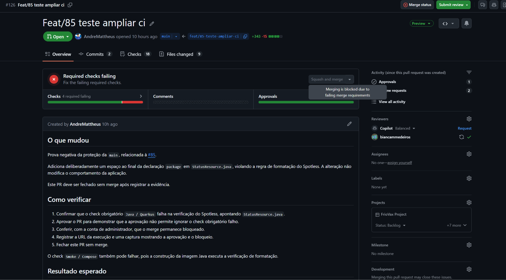

# Proteção da branch main

A `main` do FrioVax exige pull request, aprovação de outra pessoa e sucesso dos
checks obrigatórios antes de integrar alterações. As regras também se aplicam
aos administradores. O CI verifica o código e a proteção da branch transforma o
resultado dessas verificações em condição para o merge.

## Configuração

A [configuração sanitizada da API](validacao/protecao-main/2026-11-24/protecao-main.json),
consultada em 24/11/2026, registra:

| Proteção | Configuração |
|---|---|
| Pull request obrigatório | `required_pull_request_reviews` presente |
| Aprovações exigidas | `required_approving_review_count: 1` |
| Checks obrigatórios | `Java / Quarkus`, `Go / Telemetria`, `Protobuf / Buf` e `Smoke / Compose` |
| Origem dos checks | GitHub Actions (`app_id: 15368`) |
| Aplicação aos administradores | `enforce_admins.enabled: true` |
| Force push | Bloqueado (`allow_force_pushes.enabled: false`) |
| Exclusão da branch | Bloqueada (`allow_deletions.enabled: false`) |
| Branch atualizada antes do merge | Não exigida (`strict: false`) |

A [configuração de 22/11/2026](validacao/protecao-main/2026-11-22/protecao-main.json)
exigia Java e Go. A coleta de 24/11/2026 registra também Buf e Smoke, mantendo
as demais proteções. Os arquivos históricos foram preservados sem alterar
seus bytes e estão organizados por data em uma pasta comum de proteção da `main`.

Um check é o resultado de uma verificação automatizada. Neste projeto, os nomes
obrigatórios correspondem aos jobs do [workflow de CI](../../../.github/workflows/ci.yml).
Alterações nesses nomes precisam ser acompanhadas pela atualização da proteção,
para que o GitHub continue exigindo as verificações corretas.

## Bloqueio por teste Go — PR #122

O [PR #122](https://github.com/AndreMattheus/FrioVax/pull/122) contém uma falha
deliberada em um teste existente, sem alteração no código de produção. O
[commit de prova](https://github.com/AndreMattheus/FrioVax/commit/750c7729b23631525db8be231024090afe6eea82)
modificou somente a sequência esperada no cenário `sinal intermediário` de
`services/telemetry/internal/dominio/janela_test.go`:

```text
Temperaturas:          9 → 9 → 9 → 4 °C
Sequência calculada:   1 → 2 → 3 → 0
Expectativa alterada:  1 → 2 → 2 → 0
                              ↑
                       falha deliberada
```

O [job Go / Telemetria](https://github.com/AndreMattheus/FrioVax/actions/runs/45068250852/job/137349160507)
falhou em `TestAnalisarJanela/sinal_intermediário`: a candidata `r3` produziu
`Sequencia:3`, enquanto o teste exigia `2`. O
[trecho do log](validacao/protecao-main/2026-11-22/teste-falho.txt) registra a comparação
e a saída com código 1. O job
[Java / Quarkus](https://github.com/AndreMattheus/FrioVax/actions/runs/45068250852/job/137349160556)
passou na mesma execução.

Bianca [aprovou o PR intencionalmente](https://github.com/AndreMattheus/FrioVax/pull/122#pullrequestreview-6014517137)
em 22/11/2026.
Mesmo aprovado, o merge permaneceu bloqueado pelos checks obrigatórios falhos e a captura de tela abaixo registra
essa condição. A tela mostra a aprovação e a mensagem de bloqueio por falha
nos requisitos de merge. A lista de checks inclui execuções de push e de PR,
por isso o check Go falho aparece duas vezes na consulta.


O PR foi fechado **sem merge** em 22/11/2026. A [comprovação coletada](validacao/protecao-main/2026-11-22/comprovacao.json)
registra `state: CLOSED`, `mergedAt: null`, a aprovação e os checks.
O mesmo arquivo confirma que `AndreMattheus` possui permissão `admin`;
a aplicação das regras aos administradores é confirmada por
`enforce_admins.enabled: true` na configuração.

## Bloqueio por lint Java — PR #126

O [PR #126](https://github.com/AndreMattheus/FrioVax/pull/126) demonstrou o
bloqueio de uma violação de formatação com os quatro checks obrigatórios.
Seu [commit de prova](https://github.com/AndreMattheus/FrioVax/commit/67b20f6cf56c41a96d3ce7a14a779f46de797445)
parte da implementação válida `cd057d7` e adiciona somente um espaço ao final
da declaração `package` em `StatusResource.java`. O diff desse commit foi
preservado na [comprovação de 24/11/2026](validacao/protecao-main/2026-11-24/comprovacao.json).

Na [execução do PR](https://github.com/AndreMattheus/FrioVax/actions/runs/45327304271),
`Java / Quarkus` falhou no Spotless. `Smoke / Compose` também falhou porque a
construção da imagem da API executa o mesmo check na fase Maven `validate`.
Go e Buf passaram. O [trecho dos logs](validacao/protecao-main/2026-11-24/lint-falho.txt)
registra `StatusResource.java`, a violação de formatação e o código de saída 1
nos dois jobs, sem preservar o log completo de build.

Bianca [aprovou intencionalmente o PR](https://github.com/AndreMattheus/FrioVax/pull/126#pullrequestreview-6039462623)
em 24/11/2026 às 09h48min40s de Fortaleza (12h48min40s UTC), mantendo o commit
defeituoso. A consulta registrou `reviewDecision: APPROVED` e
`mergeStateStatus: BLOCKED`: aprovação não substitui o sucesso dos checks.
A captura original fornecida por Matheus mostra a aprovação e o merge
bloqueado. Há quatro resultados falhos porque Java e Smoke falharam tanto na
execução de push quanto na de pull request.



O PR foi fechado **sem merge** em 24/11/2026 às 12h00min14s de Fortaleza
(15h00min14s UTC). A comprovação preserva separadamente o estado aprovado e
bloqueado e a consulta final com `state: CLOSED`, `closedAt` preenchido e
`mergedAt: null`. A mesma coleta confirma a permissão `admin` de
`AndreMattheus`; a configuração registra a aplicação das regras aos administradores.

## Pipeline válido e duração

A [execução válida do CI](https://github.com/AndreMattheus/FrioVax/actions/runs/45325841963)
no SHA `cd057d7ee5f502685af4c77b76cf6bc6f7a0f87f`, da branch
`feat/85-ampliar-ci-e-checks-obrigatorios-estaveis`, concluiu todos os jobs com
sucesso. O artifact `java-test-reports` estava disponível e não expirado na
coleta. Seus metadados, resultados dos jobs e horários estão na comprovação
de 24/11/2026.

A duração foi **178 segundos (2min58s)**, desde a criação da execução às
04h21min38s UTC até a conclusão do último job às 04h24min36s UTC. A medida
inclui espera de runner e ficou abaixo de dez minutos. É uma execução de push
na branch da implementação; não é uma execução dessa implementação integrada
na `main`. As provas #122 e #126 foram fechadas sem integrar suas falhas.

## Coleta e reprodução

As evidências usam consultas de leitura do GitHub CLI. `protecao-main.json`
é a resposta da API com os campos relevantes selecionados por `--jq`.
`comprovacao.json` reúne respostas filtradas, horários UTC da coleta e os
argumentos exatos de cada comando; não é um log de execução do aplicativo.
`teste-falho.txt` e `lint-falho.txt` contêm apenas as linhas necessárias dos
logs. As capturas PNG são arquivos binários originais, sem edição, protegidos
pela regra `*.png binary` do `.gitattributes`. Os arquivos de texto usam UTF-8
e quebras LF. As coletas de 22 e 24/11/2026 ficam em diretórios separados.

Com GitHub CLI autenticado e acesso administrativo de leitura, os comandos
abaixo consultam as mesmas fontes. Na estação da coleta, foi usado o executável
`C:\Program Files\GitHub CLI\gh.exe`.

Configuração da proteção:

```powershell
gh api repos/AndreMattheus/FrioVax/branches/main/protection --jq '{required_status_checks,required_pull_request_reviews,enforce_admins,allow_force_pushes,allow_deletions}'
```

Fechamento e checks dos PRs de prova:

```powershell
gh pr view 122 --repo AndreMattheus/FrioVax --json number,url,state,closedAt,mergedAt,headRefOid,statusCheckRollup --jq '{number,url,state,closedAt,mergedAt,headRefOid,checks:[.statusCheckRollup[]|select(.name == "Go / Telemetria" or .name == "Java / Quarkus")|{name,conclusion,detailsUrl}]}'
```

Consulta do PR #126 (a resposta atual mostra o fechamento; o estado bloqueado
anterior está preservado na coleta):

```powershell
gh pr view 126 --repo AndreMattheus/FrioVax --json number,url,state,closedAt,mergedAt,headRefName,headRefOid,baseRefName,mergeStateStatus,reviewDecision,statusCheckRollup
```

Aprovação e permissão de administrador:

```powershell
gh api repos/AndreMattheus/FrioVax/pulls/122/reviews --jq 'map(select(.state == "APPROVED")|{login:.user.login,state,submitted_at,html_url})'
gh api repos/AndreMattheus/FrioVax/pulls/126/reviews --jq 'map(select(.state == "APPROVED")|{login:.user.login,state,submitted_at,html_url,commit_id})'
gh api repos/AndreMattheus/FrioVax/collaborators/AndreMattheus/permission --jq '{permission,role_name,login:.user.login}'
```

Log da falha e seleção do trecho preservado:

```powershell
gh run view 45068250852 --repo AndreMattheus/FrioVax --job 137349160507 --log-failed |
  Select-String -Pattern '--- FAIL: TestAnalisarJanela|janela_test.go:62:|FAIL\s+github.com/AndreMattheus/FrioVax/services/telemetry/internal/dominio|Process completed with exit code 1' |
  ForEach-Object { $_.Line }
```

Logs da prova de lint e seleção dos trechos dos dois jobs:

```powershell
foreach ($job in '138219872319', '138219872343') {
  gh run view 45327304271 --repo AndreMattheus/FrioVax --job $job --log-failed |
    Select-String -Pattern 'BUILD FAILURE|format violations|StatusResource.java|Process completed with exit code 1' |
    ForEach-Object { $_.Line }
}
```

Execução válida, duração total e relatórios Java:

```powershell
gh run view 45325841963 --repo AndreMattheus/FrioVax --json databaseId,url,event,headSha,headBranch,status,conclusion,createdAt,jobs --jq '{databaseId,url,event,headSha,headBranch,status,conclusion,createdAt,completedAt:(.jobs|map(.completedAt)|max),duration_seconds:((.jobs|map(.completedAt)|max|fromdateiso8601)-(.createdAt|fromdateiso8601)),jobs:[.jobs[]|{name,status,conclusion,completedAt}]}'
gh api repos/AndreMattheus/FrioVax/actions/runs/45325841963/artifacts --jq '{artifacts:[.artifacts[]|{name,expired,size_in_bytes}]}'
```

A comprovação também registra os argumentos exatos e os filtros de cada
consulta, incluindo os metadados da execução de prova e o diff do commit
`67b20f6`. Nenhuma consulta de coleta altera o GitHub.

Não foram preservados tokens, cabeçalhos de autenticação, logs completos ou
respostas redundantes.

Referências: [issue #86](https://github.com/AndreMattheus/FrioVax/issues/86)
e [issue #85](https://github.com/AndreMattheus/FrioVax/issues/85).
