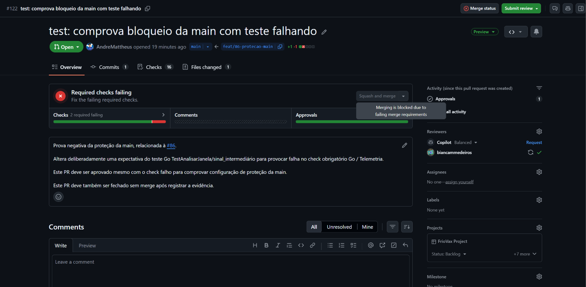

# Proteção da branch main

A `main` do FrioVax exige pull request, aprovação de outra pessoa e sucesso dos
checks obrigatórios antes de integrar alterações. As regras também se aplicam
aos administradores. O CI verifica o código e a proteção da branch transforma o
resultado dessas verificações em condição para o merge.

## Configuração

A [configuração sanitizada da API](validacao/protecao-main-86/protecao-main.json),
consultada em 22/11/2026, registra:

| Proteção | Configuração |
|---|---|
| Pull request obrigatório | `required_pull_request_reviews` presente |
| Aprovações exigidas | `required_approving_review_count: 1` |
| Checks obrigatórios | `Java / Quarkus` e `Go / Telemetria` |
| Origem dos checks | GitHub Actions (`app_id: 15368`) |
| Aplicação aos administradores | `enforce_admins.enabled: true` |
| Force push | Bloqueado (`allow_force_pushes.enabled: false`) |
| Exclusão da branch | Bloqueada (`allow_deletions.enabled: false`) |
| Branch atualizada antes do merge | Não exigida (`strict: false`) |

Um check é o resultado de uma verificação automatizada. Neste projeto, os nomes
obrigatórios correspondem aos jobs do [workflow de CI](../../../.github/workflows/ci.yml).
Alterações nesses nomes precisam ser acompanhadas pela atualização da proteção,
para que o GitHub continue exigindo as verificações corretas.

## Demonstração do bloqueio

O [PR #122](https://github.com/AndreMattheus/FrioVax/pull/122) contém uma falha
deliberada em um teste existente, sem alteração no código de produção. O
[commit de prova](https://github.com/AndreMattheus/FrioVax/commit/750c7729b23631525db8be231024090afe6eea82)
modificou somente a sequência esperada no cenário `sinal intermediário` de
`services/telemetry/internal/dominio/janela_test.go`:

```text
Temperaturas:          9 → 9 → 9 → 4 °C
Sequência calculada:   1 → 2 → 3 → 0
Expectativa alterada:  1 → 2 → 2 → 0
                              ↑
                       falha deliberada
```

O [job Go / Telemetria](https://github.com/AndreMattheus/FrioVax/actions/runs/45068250852/job/137349160507)
falhou em `TestAnalisarJanela/sinal_intermediário`: a candidata `r3` produziu
`Sequencia:3`, enquanto o teste exigia `2`. O
[trecho do log](validacao/protecao-main-86/teste-falho.txt) registra a comparação
e a saída com código 1. O job
[Java / Quarkus](https://github.com/AndreMattheus/FrioVax/actions/runs/45068250852/job/137349160556)
passou na mesma execução.

Bianca [aprovou o PR intencionalmente](https://github.com/AndreMattheus/FrioVax/pull/122#pullrequestreview-6014517137)
em 22/11/2026.
Mesmo aprovado, o merge permaneceu bloqueado pelos checks obrigatórios falhos e a captura de tela abaixo registra
essa condição. A tela mostra a aprovação e a mensagem de bloqueio por falha
nos requisitos de merge. A lista de checks inclui execuções de push e de PR,
por isso o check Go falho aparece duas vezes na consulta.



O PR foi fechado **sem merge** em 22/11/2026. A [comprovação coletada](validacao/protecao-main-86/comprovacao.json)
registra `state: CLOSED`, `mergedAt: null`, a aprovação e os checks.
O mesmo arquivo confirma que `AndreMattheus` possui permissão `admin`;
a aplicação das regras aos administradores é confirmada por
`enforce_admins.enabled: true` na configuração.

## Coleta e reprodução

As evidências usam consultas de leitura do GitHub CLI. `protecao-main.json`
é a resposta da API com os campos relevantes selecionados por `--jq`.
`comprovacao.json` reúne respostas filtradas, horários UTC da coleta e os
argumentos exatos de cada comando; não é um log de execução do aplicativo.
`teste-falho.txt` contém apenas as linhas necessárias do log do job.

Com GitHub CLI autenticado e acesso administrativo de leitura, os comandos
abaixo consultam as mesmas fontes. Na estação da coleta, foi usado o executável
`C:\Program Files\GitHub CLI\gh.exe`.

Configuração da proteção:

```powershell
gh api repos/AndreMattheus/FrioVax/branches/main/protection --jq '{required_status_checks,required_pull_request_reviews,enforce_admins,allow_force_pushes,allow_deletions}'
```

Fechamento e checks obrigatórios do PR:

```powershell
gh pr view 122 --repo AndreMattheus/FrioVax --json number,url,state,closedAt,mergedAt,headRefOid,statusCheckRollup --jq '{number,url,state,closedAt,mergedAt,headRefOid,checks:[.statusCheckRollup[]|select(.name == "Go / Telemetria" or .name == "Java / Quarkus")|{name,conclusion,detailsUrl}]}'
```

Aprovação e permissão de administrador:

```powershell
gh api repos/AndreMattheus/FrioVax/pulls/122/reviews --jq 'map(select(.state == "APPROVED")|{login:.user.login,state,submitted_at,html_url})'
gh api repos/AndreMattheus/FrioVax/collaborators/AndreMattheus/permission --jq '{permission,role_name,login:.user.login}'
```

Log da falha e seleção do trecho preservado:

```powershell
gh run view 45068250852 --repo AndreMattheus/FrioVax --job 137349160507 --log-failed |
  Select-String -Pattern '--- FAIL: TestAnalisarJanela|janela_test.go:62:|FAIL\s+github.com/AndreMattheus/FrioVax/services/telemetry/internal/dominio|Process completed with exit code 1' |
  ForEach-Object { $_.Line }
```

Não foram preservados tokens, cabeçalhos de autenticação, logs completos ou
respostas redundantes.

Referências: [issue #86](https://github.com/AndreMattheus/FrioVax/issues/86)
