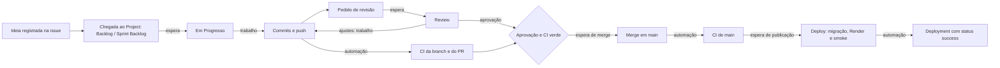

# Fluxo de valor da Sprint 2

Primeira versão do mapa de fluxo de valor da [#91](https://github.com/AndreMattheus/FrioVax/issues/91) (S2-28). Acompanha três tarefas da API, da chegada ao quadro até a publicação em produção, e sustenta o gargalo do processo com números. As regras de coleta, os tipos de intervalo e as fórmulas seguem o [plano de medição](medicao-sprint-2.md); os registros estão em [evidencias/sprint-2/](evidencias/sprint-2/README.md).

## Convenções

- Horas corridas de 3.600 segundos, calculadas com timestamps completos e arredondadas só na exibição. Os horários das tabelas estão em Fortaleza (UTC−03:00); os CSVs preservam o fuso da fonte.
- **Trabalho** é atenção humana relatada ou estimada; **automação** é a execução dos jobs do GitHub Actions, sem a fila do runner; **espera** é o tempo em que o item aguardava algo observável (fila do quadro, revisão, publicação). **Lacuna** é tempo sem registro e não vira espera nem trabalho por suposição.
- Intervalos concomitantes não são somados. Cada instante recebe uma única classificação, nesta ordem de precedência: processamento (`trabalho ∪ automação`), bloqueio, espera e lacuna. Assim, o CI que roda enquanto a autora trabalha conta uma vez, e o trabalho feito durante uma espera de revisão sai da espera.
- Estimativas (`precisao=estimado`) aparecem separadas dos relatos.

## Fluxo real da ideia à publicação



| Etapa | Classificação | Começa | Termina | Fonte |
|---|---|---|---|---|
| Fila do quadro | espera | chegada ao Project (`AddedToProjectV2`) | entrada em `Em Progresso` | timeline da issue |
| Desenvolvimento | trabalho e automação | entrada em `Em Progresso` | primeiro `review_requested` | relato da autora ou estimativa por commits; jobs do CI |
| Revisão e merge | espera, com trabalho e CI nos ajustes | primeiro pedido de revisão | merge | pedidos, reviews e evento de merge do PR |
| Integração e publicação | espera e automação | merge | publicação no ambiente `producao` | CI de `main`, deployment e jobs do workflow de deploy |

A medição começa na chegada ao Project; não há horário da ideia anterior ao registro da issue. CI e revisão podem acontecer em paralelo. A publicação é o timestamp do status `success` do deployment de produção criado pelo script, depois do smoke autenticado aprovado. Merge e CI verde não contam como publicação. Para cada item, o deploy usado é o primeiro bem-sucedido cujo SHA contém o merge do PR, conferido por ancestralidade Git. O deployment automático do environment é uma duplicata do mesmo evento e não entra novamente.

Os passos dos dois jobs de publicação estão preservados em [`validacao/fluxo-91-jobs.json`](evidencias/sprint-2/validacao/fluxo-91-jobs.json), com os comandos de consulta. Os timestamps dos statuses, reviews e pedidos são conferidos contra o corte, sem arredondar os segundos. A espera de revisão termina na review; os 22 s, 19 s e 15 s entre a última aprovação e o merge de #69, #70 e #80 são esperas separadas da etapa `merge`.

## Amostra

A amostra continua sendo [#69](https://github.com/AndreMattheus/FrioVax/issues/69) (S2-05), [#70](https://github.com/AndreMattheus/FrioVax/issues/70) (S2-06) e [#80](https://github.com/AndreMattheus/FrioVax/issues/80) (S2-16), definida em [`amostra.csv`](evidencias/sprint-2/amostra.csv).

Nenhuma das três tinha publicação comprovada em 08/11: o primeiro deploy bem-sucedido em produção preservado no corte aconteceu em 13/11, com a entrega da [#88](https://github.com/AndreMattheus/FrioVax/issues/88). A coleta não contém outra tarefa da API publicada até 08/11 que pudesse substituir a amostra. As três foram publicadas antes desta apuração e foram mantidas sem substituição. O `amostra.csv` não muda.

**Desvio do prazo:** o baseline completo de três itens publicados até 08/11 não foi entregue no prazo. A primeira versão desta apuração é de 16/11, depois das publicações de 13 e 14/11. A manutenção da amostra fica justificada aqui, antes das contas; isso não comprova um registro da decisão em 08/11 nem cumpre retroativamente o prazo. O aceite dessa pendência cabe ao revisor da #91.

## Trajeto de cada item

Tempos em horas. *Automação* é a parte da execução dos jobs que não coincide com trabalho; *espera* já exclui o processamento concomitante. Os IDs remetem a [`intervalos.csv`](evidencias/sprint-2/intervalos.csv), [`eventos.csv`](evidencias/sprint-2/eventos.csv) e [`implantacoes.csv`](evidencias/sprint-2/implantacoes.csv).

### #69 — versionar política e migrar câmaras

[PR #107](https://github.com/AndreMattheus/FrioVax/pull/107), merge `c499815`, publicado no deploy `c51e298` (`S2-pub-01`).

| Etapa | Início | Fim | Trabalho | Automação | Espera | Lacuna | Registros |
|---|---|---|---:|---:|---:|---:|---|
| Fila do quadro | 23/10 23:56:36 | 04/11 22:33:51 | 0,00 | 0,00 | 286,62 | 0,00 | `S2-69-chegada`, `S2-69-espera-backlog-01` |
| Desenvolvimento | 04/11 22:33:51 | 08/11 14:39:19 | 3,77 | 0,00 | 0,00 | 84,32 | `S2-69-trabalho-01/02` (relatado), `S2-69-automacao-01/02` |
| Revisão e merge | 08/11 14:39:19 | 09/11 00:52:31 | 0,01 | 0,04 | 10,17 | 0,00 | `S2-69-espera-01`, `S2-69-trabalho-02`, `S2-69-automacao-03..05`, `S2-69-espera-merge-01` |
| Integração e publicação | 09/11 00:52:31 | 13/11 14:53:51 | 0,00 | 0,12 | 109,90 | 0,00 | `S2-69-espera-implantacao-01`, `S2-69-automacao-06..10` |

O cartão entrou em `Em Progresso` em 04/11, mas o primeiro trabalho relatado começa em 07/11 às 22h30; esse intervalo é lacuna. A aprovação ocorreu em 09/11 às 00h52min09s e o merge às 00h52min31s. Depois do merge, o item esperou o primeiro ambiente público: três tentativas de deploy de `c51e298` falharam (11/11 e duas em 13/11) antes da publicação de 13/11 às 14h53min51s.

### #70 — persistir leituras, ocorrências e evidências

[PR #110](https://github.com/AndreMattheus/FrioVax/pull/110), merge `e7cc742`, publicado no deploy `e7cc742` (`S2-pub-02`).

| Etapa | Início | Fim | Trabalho | Automação | Espera | Lacuna | Registros |
|---|---|---|---:|---:|---:|---:|---|
| Fila do quadro | 23/10 23:56:39 | 09/11 13:16:02 | 0,00 | 0,00 | 397,32 | 0,00 | `S2-70-chegada`, `S2-70-espera-backlog-01` |
| Desenvolvimento | 09/11 13:16:02 | 13/11 15:16:52 | 3,90 | 0,09 | 0,00 | 94,03 | `S2-70-trabalho-01..03` (relatado), `S2-70-automacao-01..03` |
| Revisão e merge | 13/11 15:16:52 | 14/11 12:32:57 | 0,00 | 0,13 | 6,67 | 14,46 | `S2-70-espera-01/02`, `S2-70-automacao-04..11`, `S2-70-espera-merge-01` |
| Integração e publicação | 14/11 12:32:57 | 14/11 14:14:34 | 0,00 | 0,09 | 1,60 | 0,00 | `S2-70-espera-implantacao-01`, `S2-70-automacao-12..14` |

A revisão teve dois ciclos: pedido de alterações em 13/11 às 21h17min54s, correções informadas pela autora em 14/11 e aprovação às 12h32min38s. A segunda espera começa no novo pedido, às 11h46min01s, e termina na aprovação. O comentário de correção [6879061573](https://github.com/AndreMattheus/FrioVax/pull/110#issuecomment-6879061573) descreve mudanças e testes, mas não relata início/fim de trabalho: o antigo intervalo `S2-70-trabalho-04` (10h30–11h45, 1,25 h) foi excluído da conta por falta de fonte para os horários. O trecho sem trabalho registrado fica como lacuna, preservando apenas os jobs observados. O deploy automático após o merge falhou em 7 segundos; a publicação saiu por disparo manual às 14h11, com sucesso às 14h14min34s.

### #80 — autenticar usuários e revogar sessões

[PR #103](https://github.com/AndreMattheus/FrioVax/pull/103), merge `b166cf4`, publicado no deploy `c51e298` (`S2-pub-01`).

| Etapa | Início | Fim | Trabalho | Automação | Espera | Lacuna | Registros |
|---|---|---|---:|---:|---:|---:|---|
| Fila do quadro | 23/10 23:56:55 | 04/11 18:28:39 | 3,00 (estimado) | 0,00 | 279,43 | 0,09 | `S2-80-espera-backlog-01/02`, `S2-80-trabalho-01..03`, `S2-80-automacao-01` |
| Desenvolvimento | 04/11 18:28:39 | 04/11 19:22:41 | 0,81 (estimado) | 0,06 | 0,00 | 0,03 | `S2-80-trabalho-04`, `S2-80-automacao-01/02` |
| Revisão e merge | 04/11 19:22:41 | 06/11 12:43:58 | 1,19 (estimado) | 0,07 | 38,09 | 2,01 | `S2-80-espera-01..03`, `S2-80-trabalho-04/05`, `S2-80-automacao-03..07`, `S2-80-espera-merge-01` |
| Integração e publicação | 06/11 12:43:58 | 13/11 14:53:51 | 0,00 | 0,12 | 170,05 | 0,00 | `S2-80-espera-implantacao-01`, `S2-80-automacao-08..12` |

Todo o trabalho da #80 é estimado pelos commits (blocos de 60 minutos). Três blocos antecedem a entrada do cartão em `Em Progresso`: o trabalho começou antes da atualização do quadro e, pela precedência, saiu da espera de fila. Em 03/11 o cartão passou cinco minutos em `Em Progresso` e voltou ao Backlog; esse trecho sem registro é a lacuna de 0,09 h. A revisão teve três ciclos, e o terceiro pedido esperou 37,59 h pela aprovação.

## Eficiência de fluxo

`eficiência = 100 × processamento / (publicação − chegada)`, com `processamento = U(trabalho ∪ automação)` na janela do item.

| Item | Lead até publicação (h) | Trabalho (h) | dos quais estimado | Automação (h) | Processamento (h) | Espera (h) | Lacuna (h) | Eficiência |
|---|---:|---:|---:|---:|---:|---:|---:|---:|
| #69 | 494,95 | 3,78 | 0,00 | 0,22 | 3,94 | 406,69 | 84,32 | 0,80% |
| #70 | 518,30 | 3,90 | 0,00 | 0,31 | 4,21 | 405,59 | 108,49 | 0,81% |
| #80 | 494,95 | 5,00 | 5,00 | 0,25 | 5,25 | 487,57 | 2,13 | 1,06% |

**Média aritmética das três eficiências: 0,89%.** A automação da tabela é a união completa dos jobs; no processamento entra só a parte que não coincide com trabalho (0,16 h na #69, 0,31 h na #70 e 0,25 h na #80). Nenhum item teve bloqueio registrado.

Os três itens passaram cerca de 99% do lead esperando ou sem registro. O componente de trabalho da #80 é estimado; os da #69 e da #70 vêm de relatos. A automação é observada nos três. As eficiências são parciais quanto à cobertura de trabalho; a lacuna não comprova inatividade. Por isso as três não são comparáveis entre si como medida de produtividade, e não são usadas assim.

### Conferência manual da #69

1. Lead: 13/11 14:53:51 − 23/10 23:56:36 = 20 d 14 h 57 min 15 s = **494,954 h**.
2. Trabalho relatado: 22h30–00h37 (2 h 07 min) + 13h00–14h40 (1 h 40 min) = **3,783 h**.
3. Automação fora do trabalho: os jobs de 07/11 23:03 e 08/11 14:36 caem dentro do trabalho relatado. Restam 38 s (14:40:00–14:40:38), 108 s (14:51:48–14:53:36, união dos dois runs), 103 s (CI de `main` 00:52:36–00:54:19) e as tentativas de deploy: 7 s + 7 s + 88 s + 218 s (este último cortado no status de sucesso, às 14:53:51). Total: 569 s = **0,158 h**.
4. Processamento: (13.620 + 569) / 3.600 = **3,941 h**. Eficiência: 100 × 14.189 / 1.781.835 = **0,80%**, usando segundos sem arredondar.
5. Espera: fila 1.031.835 s; revisão e merge 36.792 s (14:39:19–00:52:31) menos 41 s de trabalho e 146 s de CI = 36.605 s; publicação 396.080 s menos 423 s de CI e deploy = 395.657 s. Total 1.464.097 s = **406,69 h**. Lacuna: (1.781.835 − 14.189 − 1.464.097) / 3.600 = **84,32 h**, que é sobretudo o intervalo entre `Em Progresso` (04/11 22:33) e o primeiro relato (07/11 22:30).

## Gargalo

O maior componente observado do lead é a **fila do quadro**. A revisão é uma oportunidade específica de melhoria: a cauda de espera da Sprint 1 e o terceiro ciclo da #80 sustentam o experimento da [#92](https://github.com/AndreMattheus/FrioVax/issues/92). Os números não mostram a revisão como a maior espera dos três itens, nem permitem atribuir toda lacuna a espera.

### Espera até a primeira revisão — linha de base da Sprint 1

Definição usada na linha de base da #92: da abertura do PR (ou da primeira saída de rascunho) até a primeira review submetida (`APPROVED`, `CHANGES_REQUESTED` ou `COMMENTED`) por outra pessoa, excluindo bots e autorreview. Entram os PRs #36–#64 integrados em `main`.

```bash
python3 docs/scripts/medir-fluxo-de-valor.py revisao docs/evidencias/sprint-2/exportacoes/20261103T192538818629Z
```

| Medida | Resultado |
|---|---:|
| PRs integrados com review de outra pessoa | 26 (o #63 não foi integrado; o #54 e o #61 não são PRs) |
| Acima de 24 h corridas | **6 de 26 (23,1%)** |
| Mediana | **5,32 h** |
| Máximo | **62,06 h** ([#55](https://github.com/AndreMattheus/FrioVax/pull/55)) |

Os seis acima de 24 h: [#55](https://github.com/AndreMattheus/FrioVax/pull/55) 62,06 h, [#53](https://github.com/AndreMattheus/FrioVax/pull/53) 53,06 h, [#47](https://github.com/AndreMattheus/FrioVax/pull/47) 34,11 h, [#62](https://github.com/AndreMattheus/FrioVax/pull/62) 25,96 h, [#38](https://github.com/AndreMattheus/FrioVax/pull/38) 25,77 h e [#43](https://github.com/AndreMattheus/FrioVax/pull/43) 24,18 h. O comando reproduz exatamente os 23%, a mediana de 5,3 h e o máximo de 62,1 h registrados na #92 em 21/10.

### Espera no backlog — Sprint 1

Pela [apuração de 15/10](metricas-sprint-1.md#resultados), o lead time médio dos 24 cartões técnicos foi **11,68 dias** e o cycle time médio, **1,35 dia**. A diferença é **10,33 dias (cerca de 88,5% do lead médio)**. O comando abaixo reproduz esses valores pela tabela publicada, já arredondada; não é uma nova coleta dos timestamps originais.

```bash
python3 docs/scripts/medir-fluxo-de-valor.py backlog
```

Essa diferença mede o intervalo até o início operacional adotado na Sprint 1. Em 17 de 24 cartões, o início é aproximado pela abertura do PR: pode incluir desenvolvimento anterior ao PR, portanto não comprova 10,33 dias de inatividade. A fila da Sprint 2 é medida por eventos de status e exclui trabalho e automação concomitantes.

### Amostra da Sprint 2

Participação de cada classificação no lead até a publicação:

| Item | Fila do quadro | Revisão e merge | Integração e publicação | Processamento | Lacuna |
|---|---:|---:|---:|---:|---:|
| #69 | 57,9% | 2,1% | 22,2% | 0,8% | 17,0% |
| #70 | 76,7% | 1,3% | 0,3% | 0,8% | 20,9% |
| #80 | 56,5% | 7,7% | 34,4% | 1,1% | 0,4% |

- **A fila do quadro domina** (56–77% do lead). Parte disso é estrutural: as 35 tarefas foram adicionadas ao quadro em lote em 24/10 UTC (23/10 em Fortaleza), e o lead contado desde a chegada inclui o tempo em que a tarefa ainda dependia de outras. A comparação com a Sprint 1 tem a limitação da aproximação do início por PR.
- **A espera de publicação da #69 e da #80** (110 h e 170 h) é pontual: não existia ambiente público antes de 13/11. A #70, integrada com o ambiente já no ar, esperou 1,6 h.
- **A revisão** teve espera menor que a fila e a publicação nas #69 e #80 (10,2 h e 38,1 h no total); a #70 esperou 6,7 h por revisão. O terceiro ciclo da #80 esperou 37,6 h. Na linha de base, quase um em cada quatro PRs esperou mais de um dia. O experimento da #92 compara esse número com os PRs da Sprint 2.

## Reprodução

```bash
python3 docs/scripts/validar-medicao-sprint-2.py
python3 docs/scripts/medir-fluxo-de-valor.py itens
python3 docs/scripts/medir-fluxo-de-valor.py revisao docs/evidencias/sprint-2/exportacoes/20261117T023019358359Z
python3 docs/scripts/medir-fluxo-de-valor.py backlog
python3 -m unittest discover -s docs/scripts -p 'test_fluxo_de_valor.py' -v
```

O subcomando `itens` confere CSVs, corte preservado, passos de smoke e histórico Git local, sem consultar a API. Exige clone com histórico completo (`fetch-depth: 0` no CI). Falha para intervalos em curso, segundos divergentes, pausas contadas como automação, esperas de etapas distintas sobrepostas, publicação sem smoke ou SHA que não contenha o merge. Confere também se foi usada a primeira publicação válida, em vez de confiar apenas na lista de PRs do CSV. `--corte` e `--pasta` permitem conferir outra coleta explicitamente.

O corte [`20261117T023019358359Z`](evidencias/sprint-2/exportacoes/20261117T023019358359Z/manifesto.json) (16/11, 23h30, 292 consultas paginadas) preserva os eventos de quadro, reviews, runs, jobs, deployments e statuses citados nos registros. Ele reproduz a mesma linha de base do corte de 03/11. Os cortes históricos permanecem intactos; o arquivo complementar de jobs preserva as etapas de Render e smoke usadas nesta conferência.

## Limites

- **Amostra pequena (n=3)**, escolhida antes da execução por ser código da API publicado. Não representa o throughput da sprint nem sustenta comparação entre pessoas.
- **Cobertura parcial do trabalho.** Os relatos de #69 e #70 são limites inferiores do trabalho registrado: há commits fora dos intervalos relatados, por exemplo #69 em 08/11 às 14h51 e #70 em 14/11 às 12h03 e 12h21, que não foram transformados em trabalho porque só a autora pode relatar ou estimar o próprio tempo. A estimativa da #80 usa blocos de uma hora, não comprova atenção contínua e não é um limite inferior garantido.
- **Lacuna não é espera.** Na #69 e na #70, a maior parte da lacuna fica entre a entrada em `Em Progresso` e o primeiro relato. O cartão em andamento não comprova trabalho.
- **Chegada em lote.** A chegada de todos os itens é a inclusão no Project em 24/10 UTC (23/10 em Fortaleza), anterior à planning da Sprint 2 de 03/11. A dependência entre tarefas (por exemplo, #70 depende da #69) aparece como fila do quadro; não foi registrada como bloqueio separado.
- A fila do runner foi excluída da automação e não foi registrada como espera; soma segundos por execução.
- Só as duas publicações usadas pela amostra estão em `implantacoes.csv`. As tentativas falhas e as publicações posteriores ficam para a [#90](https://github.com/AndreMattheus/FrioVax/issues/90), que também apura a frequência de implantação.
- A linha de base de revisão conta a partir da abertura do PR, como foi medida na Sprint 1. O protocolo da Sprint 2 conta a partir do `review_requested`; a comparação da #92 deve usar uma única definição nos dois períodos.
- O prazo de 08/11 permanece descumprido. Este documento entrega as contas e fontes depois da publicação dos três itens; a aprovação depende de o revisor aceitar expressamente esse desvio, além de reproduzir a validação e verificar a DoD.
