# Fluxo de valor da Sprint 2

Primeira versão do mapa de fluxo de valor da [#91](https://github.com/AndreMattheus/FrioVax/issues/91) (S2-28). Acompanha três tarefas da API, da chegada ao quadro até a publicação em produção, e sustenta o gargalo do processo com números. As regras de coleta, os tipos de intervalo e as fórmulas seguem o [plano de medição](medicao-sprint-2.md); os registros estão em [evidencias/sprint-2/](evidencias/sprint-2/README.md).

## Convenções

- Horas corridas de 3.600 segundos, calculadas com timestamps completos e arredondadas só na exibição. Os horários das tabelas estão em Fortaleza (UTC−03:00); os CSVs preservam o fuso da fonte.
- **Trabalho** é atenção humana relatada ou estimada; **automação** é a execução dos jobs do GitHub Actions, sem a fila do runner; **espera** é o tempo em que o item aguardava algo observável (fila do quadro, revisão, publicação). **Lacuna** é tempo sem registro e não vira espera nem trabalho por suposição.
- Intervalos concomitantes não são somados. Cada instante recebe uma única classificação, nesta ordem de precedência: processamento (`trabalho ∪ automação`), bloqueio, espera e lacuna. Assim, o CI que roda enquanto a autora trabalha conta uma vez, e o trabalho feito durante uma espera de revisão sai da espera.
- Estimativas (`precisao=estimado`) aparecem separadas dos relatos.

## Fluxo real da ideia à publicação

```mermaid
flowchart LR
    A[Planning: issue criada] --> B[Backlog / Sprint Backlog]
    B -->|espera| C[Em Progresso]
    C -->|trabalho| D[Commits e push]
    D -->|automação| E[CI do PR]
    E --> F[Pedido de revisão]
    F -->|espera| G[Review]
    G -->|ajustes: trabalho + CI| F
    G -->|aprovação| H[Merge em main]
    H -->|automação| I[CI de main]
    I -->|espera| J[Deploy: migração, Render, smoke]
    J -->|automação| K[Publicado em produção]
```

| Etapa | Classificação | Começa | Termina | Fonte |
|---|---|---|---|---|
| Fila do quadro | espera | chegada ao Project (`AddedToProjectV2`) | entrada em `Em Progresso` | timeline da issue |
| Desenvolvimento | trabalho e automação | entrada em `Em Progresso` | primeiro `review_requested` | relato da autora ou estimativa por commits; jobs do CI |
| Revisão | espera, com trabalho e CI nos ajustes | primeiro pedido de revisão | merge | eventos e reviews do PR |
| Integração e publicação | espera e automação | merge | publicação no ambiente `producao` | CI de `main`, deployment e jobs do workflow de deploy |

A publicação é o fim da etapa *Publicar SHA e esperar Render* do job que cria o GitHub deployment com status `success`; o smoke autenticado termina segundos depois no mesmo job. Merge e CI verde não contam como publicação. Para cada item, o deploy usado é o primeiro bem-sucedido cujo SHA contém o merge do PR.

## Amostra

A amostra continua sendo [#69](https://github.com/AndreMattheus/FrioVax/issues/69) (S2-05), [#70](https://github.com/AndreMattheus/FrioVax/issues/70) (S2-06) e [#80](https://github.com/AndreMattheus/FrioVax/issues/80) (S2-16), definida em [`amostra.csv`](evidencias/sprint-2/amostra.csv).

Nenhuma das três estava publicada em 08/11, e não havia como estar: o primeiro deploy bem-sucedido em produção aconteceu em 13/11, com a entrega da [#88](https://github.com/AndreMattheus/FrioVax/issues/88). Até essa data nenhuma tarefa da API tinha sido publicada, então a troca prevista para 08/11 não tinha substituta válida. As três foram publicadas antes desta apuração e foram mantidas sem substituição. O `amostra.csv` não muda.
